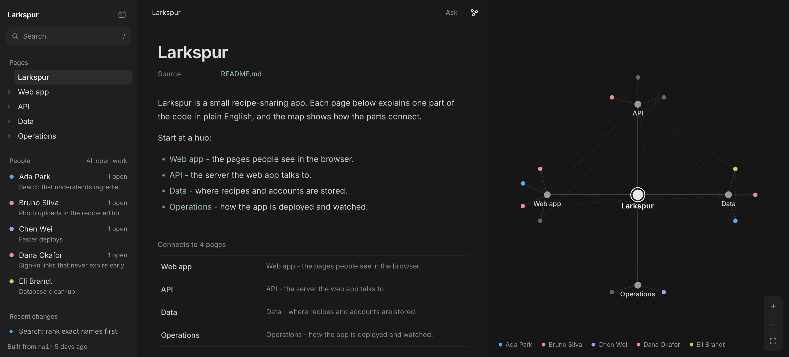

<h1 align="center">Hypatia</h1>

<p align="center">
  <a href="https://www.npmjs.com/package/hypatia"></a>
  <a href="https://www.npmjs.com/package/hypatia"></a>
  <a href="LICENSE"></a>
  <a href="https://github.com/maxhawksby/hypatia/stargazers"></a>
</p>

<h3 align="center">A living team wiki for any git repo, kept current by your coding agent.</h3>

<p align="center"></p>

Hypatia turns your repo's Markdown into a team wiki.
One page per part of the code, a map of how the parts connect, and who is working on what.
Your coding agent keeps the pages true to the code. Node 18+, no dependencies.

## Quick start

```shell
npx hypatia init     # set it up in this repo
npx hypatia serve    # open the wiki at http://localhost:4410/
```

Or ask your coding agent:

```
Install Hypatia in this repo by following https://raw.githubusercontent.com/maxhawksby/hypatia/main/INSTALL-AGENT.md
```

## What you get

- **Map**: every page is a node, linked the way the code is, like an Obsidian graph.
- **Team view**: who is working on which part, from branches, issues and pull requests. No status sheet.
- **Agent skill**: Claude Code, Codex or Cursor updates the pages when the code changes.
- **Website**: public repos publish to GitHub Pages; private repos open locally with one command.
- **Privacy guard**: emails, phone numbers and keys never reach the website.

## Docs

**[Read the wiki](https://maxhawksby.github.io/hypatia/)** - docs, how it works, and how it came together. It is Hypatia's own wiki, built by Hypatia. In the repo: [start here](docs/wiki/start-here.md), [how it works](docs/wiki/how-it-works.md), [how it came together](docs/wiki/how-it-came-together.md).

If Hypatia helps your team, star the repo. Issues and pull requests are welcome: see [CONTRIBUTING.md](CONTRIBUTING.md).
